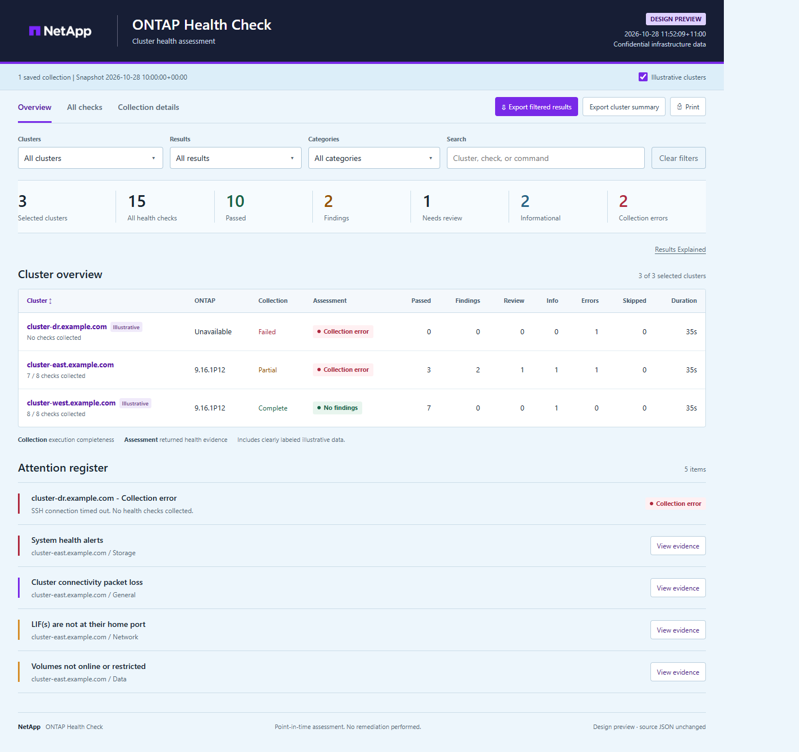

# ONTAP Health Check (PowerShell)

**Version 0.2** | Updated 2026-10-30 | [Release history](#release-history)

Collect health-check evidence from **NetApp ONTAP 9** clusters over SSH and generate one interactive, self-contained HTML report. Review General, Security, Storage, Network, and Data checks across one or more clusters, inspect the CLI evidence, and export filtered results to CSV.

No remediation or persistent configuration changes are performed. Diagnostics run by default and may initiate tests or refresh diagnostic state. Results are a point-in-time assessment, not an overall cluster-health verdict.

## Requirements

- **Windows PowerShell 5.1 or PowerShell 7 on Windows.**
- **Windows OpenSSH Client 8.4+** (`ssh.exe`). Check with `ssh -V`.
- SSH access to each cluster's management address and an ONTAP account with advanced CLI privilege and permission to run the checks.
- Password or single-password keyboard-interactive authentication. Multi-step MFA is not supported.

No additional PowerShell modules are required.

## Quick Start

1. Download and extract the **whole repository**, or clone it, then open PowerShell in its folder. Keep the root script, `Modules`, and `ReportAssets` together; downloading only the root script is not enough. If Windows blocks the downloaded PowerShell files, review them and unblock them:

   ```powershell
   Get-ChildItem . -Recurse -File -Include *.ps1,*.psm1,*.psd1 | Unblock-File
   ```

2. Establish SSH trust for each cluster. Obtain its host-key fingerprint from a trusted administrator or management channel, then connect and compare it **before accepting**:

   ```powershell
   ssh -F NUL -o StrictHostKeyChecking=ask -l admin cluster-mgmt.example.com
   ```

   Replace `admin` with your ONTAP username. Exit the SSH session after verifying the key. Do not accept an unverified fingerprint or bypass a changed-key warning.

3. Run the health check and enter your credentials when prompted:

   ```powershell
   .\ONTAPHealthCheck.ps1 cluster-mgmt.example.com -OpenReport
   ```

   The report opens when collection and HTML generation finish. Without `-OpenReport`, open the HTML file at the path printed in the console:

   ```text
   Reports/<run-timestamp>/ONTAP-Health-Report.html
   ```

Running `.\ONTAPHealthCheck.ps1` without arguments prompts for cluster names or IP addresses first. Use bare hostnames, FQDNs, or IP addresses, not URLs or `user@host` values.

### More Examples

```powershell
# Check several clusters; choose whether to reuse credentials when prompted
.\ONTAPHealthCheck.ps1 cluster1 cluster2 192.0.2.10 -OpenReport

# Read cluster targets from a text file
.\ONTAPHealthCheck.ps1 -ClusterFile .\clusters.txt -OpenReport

# Keep the per-cluster JSON as well as the HTML report
.\ONTAPHealthCheck.ps1 cluster1 -KeepAllOutputFiles
```

## Report Preview



[Download the interactive HTML sample](samples/ONTAP-Health-Report.html) using GitHub's **Download raw file** button, then open it in a browser. The sample uses synthetic data only; no cluster access is needed. GitHub's repository file viewer does not run HTML or JavaScript.

Your generated report works offline and can be shared as a single HTML file. It includes cluster summaries, clickable totals, filters, expandable check evidence, and CSV exports. Reports contain sensitive infrastructure data: store and share real reports securely, and do not commit them to GitHub. JSON is removed after successful HTML generation unless you use `-KeepAllOutputFiles`.

Node model `SIMBOX` is flagged as a Virtual ONTAP Simulator, a test/lab platform that is not supported for production. On SIMBOX-only clusters, General checks explicitly rejected by ONTAP as unsupported on the platform are marked **Skipped**, with a **Not applicable to platform** explanation and their raw responses retained. Other collection failures remain errors. Older saved collections without node-model inventory must be recollected to enable this detection.

## Detailed Reference

See [README - Detailed.md](README%20-%20Detailed.md) for SSH trust options, unattended runs, output retention and recovery, check assessments, diagnostic caveats, security details, and regression tests.

## Release History

### 0.2 - 2026-10-30

- Added node-model inventory and clear warnings identifying SIMBOX as a Virtual ONTAP Simulator, not a supported production-ready platform.
- Marked General checks explicitly rejected as platform-unsupported on SIMBOX-only clusters as **Skipped**, with a **Not applicable to platform** explanation and raw evidence retained. Other collection failures remain errors.
- Improved expanded check boundaries so neighboring results, including hardware-assisted failover and storage-port checks, are clearly separated. Saved evidence for those checks was already independent.
- Added regression coverage for simulator detection, platform applicability, and generated reports; verified the report layout on desktop and mobile.
- Added release metadata to production scripts and modules. This is the tool's release version, separate from the collected ONTAP version and required PowerShell version.

Existing collections without node-model inventory must be recollected for simulator detection. The standalone ONTAP.Ssh module's behavior is unchanged; the runner uses ONTAP.HealthCheck.

### 0.1

Initial release: SSH-based ONTAP health-check collection, per-cluster evidence, and a self-contained interactive HTML report.

## License

Code is provided under the [MIT License](LICENSE), without warranty. NetApp and ONTAP names and the NetApp logo are trademarks of NetApp, Inc.; the code license does not grant trademark rights. This is a community tool, not an official NetApp support assessment.
